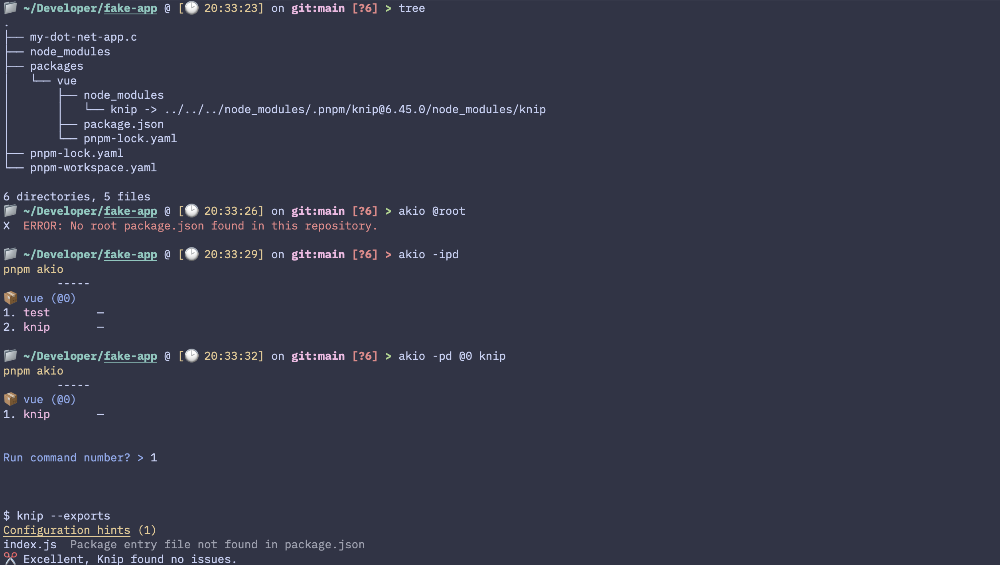

# Monorepos without a root package.json

## Context
Not every repo akio runs in is JS-rooted - e.g. a dotnet/go host repo with an npm sub-package at `packages/vue` and nothing at the repo root. No root `package.json` means nothing to anchor `@root` to, or to pin as `@0`.

## Decision
- `@root` always errors: `"No root package.json found in this repository."` - there's nothing to point it at.
- everything else still works as normal: `glob` finds packages anywhere in the repo, `pinRootFirst` just sorts alphabetically (no root to pin), and `@<N>`/`@<name>` targeting works unchanged - the first package found is simply `@0`, not root.
- considered requiring a root `package.json` always: rejected, forces a dummy file on otherwise-valid non-JS-rooted repos.
- considered synthesizing a fake root entry: rejected, a clear `@root` error beats silently faking one.

Screenshot (project with no root package.json, akio still lists `packages/vue`): 

## Tradeoffs:
1. Regressions won't be caught by akio's own test suite - akio's repo needs its own root `package.json` to run vitest/eslint at all, so a "no root" fixture can't live in-repo without breaking the harness that runs the tests. This isn't a gap that can be closed - verify behavior manually against a real non-JS-rooted repo instead (e.g. a playground, `~/Developer/fake-app` shown in the screenshot above) when touching this path.
